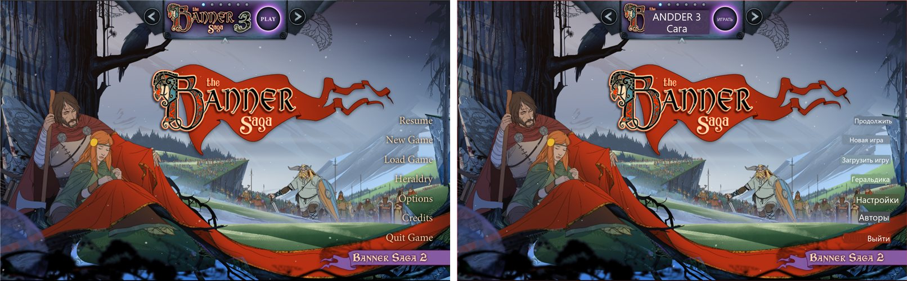

# WinDecky Translator

[](https://github.com/Aqvilinus/windecky-translator/releases)
[](https://github.com/Aqvilinus/windecky-translator/actions/workflows/build-windows.yml)
[](LICENSE)

Translate any text on your screen while you play in Steam Big Picture on Windows. WinDecky Translator is a [Decky Loader](https://github.com/SteamDeckHomebrew/decky-loader) plugin: press one shortcut in a game, and it captures the game window, reads the text with OCR, translates it and draws the translation right over the original lines. Handy for games that were never localized, or for learning a language while you play.



It is based on [Decky Translator](https://github.com/cat-in-a-box/Decky-Translator) by cat-in-a-box, rebuilt for Windows. It is a separate project with its own releases, and it is not affiliated with Valve, Microsoft or Google.

## Requirements

- Windows 11, 64-bit (Windows 10 may work but is untested)
- Steam in Big Picture mode
- [Decky Loader](https://github.com/SteamDeckHomebrew/decky-loader) for Windows (tested with 3.3.1)
- An internet connection for the web engines and for the one-time downloads of the on-device engines

Developed and tested on a OneXPlayer handheld (Intel Core Ultra, Arc graphics) running Windows 11 in full screen mode. Any Windows PC with Steam Big Picture should work.

## Install

1. Download `decky-translator-windows.zip` from the [latest release](https://github.com/Aqvilinus/windecky-translator/releases/latest).
2. In Big Picture, open the Quick Access menu, go to the Decky tab and open Decky's settings.
3. Turn on **Developer Mode** (General tab), then in the **Developer** tab choose **Install Plugin from ZIP File** and pick the zip. Instead of downloading, you can also use **Install Plugin from URL** with the zip's link.

During the install Decky Loader also downloads `plugin-dependencies.tar.gz` from the same release (about 130 MB: a portable Python 3.14 and the plugin's Python packages). Its SHA-256 is checked against the one in the plugin's `package.json`, and the plugin unpacks it into its `bin` folder on the first start, so the first start takes a little longer.

To update, install the newer zip the same way. Your settings and downloaded engines are kept.

## How to use

### From the side menu

Open the Quick Access menu, go to the Decky tab, open **WinDecky Translator** and press **Translate**. The menu closes, and a moment later the translation appears over the game. Press **Close Overlay** in the same place, or the shortcut below, to close it.

Opening any Steam side menu while a translation is on screen closes the translation, so it never covers the menu.

### With the shortcut

Press **Ctrl+Alt+T** in a game to translate, and press it again to close the translation. The shortcut works only while a game started from Steam is in front; everywhere else Ctrl+Alt+T keeps its usual meaning.

To translate with a controller, map Ctrl+Alt+T to a button: in your handheld's own app (for example OneXConsole on OneXPlayer) or in the game's Steam Input layout. The plugin can't listen to controller buttons itself, because Windows sends controller input only to the app in front.

## Engines

Translation happens in two steps: text recognition (OCR) finds the text on the screenshot, and a translation engine translates it. You pick both in the plugin's **Translation** tab. Several options are free and need no account at all.

### Text recognition

| Engine | Where it runs | Key | Notes |
| --- | --- | --- | --- |
| **On-Device (Chrome)** (default) | Your PC | None | Google's Chrome Screen AI engine. Best quality, detects 70+ languages by itself. One-time 80 MB download. |
| **On-Device (RapidOCR)** | Your PC | None | PaddleOCR models. 27 languages; you choose the input language. One-time 75 MB download. |
| **On-Device (Windows OCR)** | Your PC | None | Built into Windows, nothing to download. Each language needs its Windows language pack, and stylized game fonts are often misread. |
| **OCR.space** | Web | None | Free cloud OCR. Limited to 500 requests a day and 10 per 10 minutes. |
| **Google Cloud Vision** | Web | Google Cloud | Very accurate and fast. 1,000 free requests a month, then paid. |
| **Gemini Vision** | Web | Gemini | Recognizes and translates in one request, so no separate translation engine is used. Great with stylized text, but slower. |

### Translation

| Engine | Where it runs | Key | Notes |
| --- | --- | --- | --- |
| **Google Translate** (default) | Web | None | Free. If Google rate-limits you, Microsoft Bing's free translator takes over for 15 minutes. |
| **AI Translation: Groq** | Web | Groq (free) | Sends the whole screen in one request, so lines are translated in context. Fast; the free tier allows about 1,000 requests a day. |
| **AI Translation: Gemini** | Web | Gemini (free) | Same idea as Groq. In the EU/EEA, the UK and Switzerland, Google's terms allow only paid use, so you need billing on the key's project. |
| **AI Translation: Custom server** | Web or your PC | Depends | Any OpenAI-compatible API: OpenRouter, a local llama.cpp server and so on. |
| **On-Device (NLLB-200)** | Your PC | None | Meta's NLLB-200 model, fully offline after a one-time 1.4 GB download. No auto-detect: choose the input language. Experimental. |
| **Google Cloud Translation** | Web | Google Cloud | High quality. 500,000 free characters a month, then paid. |

When AI Translation can't answer (no key yet, the service is down or you hit its limit), Google Translate and then Bing step in, so you always get a translation.

A good free setup is **On-Device (Chrome)** for recognition and **AI Translation: Groq** for translation. If you don't want to create any account, use **Google Translate**.

### Getting a key

Press the key button next to the engine in the Translation tab and paste the key (the dialog has a **Paste** button).

- **Groq:** sign in at [console.groq.com](https://console.groq.com/keys), open **API Keys** and create a key. No card is needed.
- **Gemini:** sign in at [Google AI Studio](https://aistudio.google.com/app/apikey) and create a key. The same key works for AI Translation and for Gemini Vision.
- **Google Cloud:** in the [Google Cloud Console](https://console.cloud.google.com/) create a project, enable the **Cloud Vision API** and/or the **Cloud Translation API**, then create an API key under **APIs & Services > Credentials**. Restricting the key to those two APIs and setting a budget alert under **Billing > Budgets & alerts** is a good idea.

Treat your keys like passwords and don't share them.

## Settings worth knowing

- **Input Language / Output Language:** what to translate from and to. Auto-detect works with every engine except On-Device (NLLB-200).
- **Faster Recognition / Faster Translation:** keep an on-device engine loaded between translations. Faster, but uses more memory.
- **Cache Translations:** remembers translated lines, so text you have already seen is shown instantly and isn't sent again. **View Cached Translations** lets you browse and clear the cache.
- **Pause Game While Translating:** suspends the game while the translation is on screen and resumes it when you close the translation. It is off by default. It doesn't work well with game streaming (Moonlight, GeForce NOW, Remote Play), and an online game may lose its connection while paused.
- **Font Scaling:** makes the translated text bigger, for example on a large external monitor.
- **Customize Recognition:** fine-tuning for RapidOCR and Google Cloud Vision when they miss text or pick up noise.
- **Debug Mode:** writes detailed logs and shows a small diagnostics panel (shortcut state, the app in front, the last capture size).

## Privacy

- The screenshot leaves your PC only if you choose a web recognition engine: OCR.space, Google Cloud Vision or Gemini Vision. The on-device engines read it locally.
- The recognized text is sent to the translation engine you choose: Google Translate (and Bing when it takes over), Groq, Gemini, your custom server or Google Cloud. On-Device (NLLB-200) translates locally.
- The on-device engines are downloaded once when you first use them: Chrome Screen AI from Google's Chrome component server, the RapidOCR models from GitHub and Hugging Face, NLLB-200 from Hugging Face.
- Settings, including your API keys, are stored in plain text in `%USERPROFILE%\homebrew\settings\decky-translator\`. The translation cache is stored there too.
- The plugin has no analytics or telemetry.

## Known limitations

- Arabic, Hebrew, Thai and other scripts that need text shaping are drawn without it in the overlay, so letters may look disconnected or in the wrong order.
- The overlay is drawn on a still image of the game, so it doesn't follow the game if the scene changes; translate again.
- The shortcut can't be changed yet, and it works only while a game started from Steam is in front.
- Windows OCR needs the Windows language pack (with text recognition) for every language you read: Settings > Time & language > Language & region.

## Troubleshooting

- **Nothing happens or the result is poor:** try another recognition engine first (On-Device (Chrome) is usually the best), then another translation engine.
- **"Wrong API key":** check the key for typos and make sure the right API is enabled for it.
- **Text is too small:** raise **Font Scaling** in the settings tab.
- **Reporting a bug:** turn on **Debug Mode**, reproduce the problem and attach the log from `%USERPROFILE%\homebrew\logs\decky-translator\` to a [new issue](https://github.com/Aqvilinus/windecky-translator/issues/new).

## Development

You need Node.js (pnpm comes through `corepack`) and Python 3.14.

```powershell
git clone https://github.com/Aqvilinus/windecky-translator.git "$env:USERPROFILE\homebrew\plugins\decky-translator"
cd "$env:USERPROFILE\homebrew\plugins\decky-translator"
corepack pnpm install
corepack pnpm run build
python scripts/build_windows.py --version dev --skip-frontend
```

The last command builds `out/plugin-dependencies.tar.gz`; copy it into `bin/`, and the plugin unpacks it on its next start. Installing a release zip over a clone replaces the clone.

Tests:

- `corepack pnpm run typecheck` and `corepack pnpm test` run the type check and the unit tests (`tests/frontend`). CI runs both on every push.
- `corepack pnpm test:e2e` runs the end-to-end tests on the device itself. It needs Steam Big Picture with Decky Loader and an installed Steam game (The Banner Saga by default; set `E2E_APPID` and `E2E_WINDOW` for another one). It starts the game if it isn't running, translates with Ctrl+Alt+T and with the side menu button, reloads the plugin, and checks the overlay and the translated screen (screenshots go to `tests/e2e/artifacts`). It takes over the screen and keyboard for about a minute, so don't use the device meanwhile.

### Versions and releases

Versions follow [semantic versioning](https://semver.org/), starting at 1.0.0, independent of Decky Translator's versions. The version in `package.json` is the current one, and the release tag is the same number without a prefix (`1.0.0`).

To release, run the **Build Windows** workflow from the Actions tab with `release_version` set to the new version. It builds the zip and `plugin-dependencies.tar.gz` and publishes them as a draft release tagged with that version; the zip's download link for the dependencies points at that release.

## License and credits

WinDecky Translator is licensed under the [GNU GPL v3.0](LICENSE), like the project it is based on. Third-party components and their licenses are listed in [THIRD_PARTY_LICENSES](THIRD_PARTY_LICENSES). The NLLB-200 model is licensed by Meta for non-commercial use only; the plugin doesn't ship it, you download it from Hugging Face when you choose it.

Thanks to:

- [cat-in-a-box](https://github.com/cat-in-a-box) for [Decky Translator](https://github.com/cat-in-a-box/Decky-Translator), which this port is built on: its interface, text grouping, translation cache and engines.
- The [Decky Loader](https://github.com/SteamDeckHomebrew/decky-loader) team for the plugin framework.
- [Chromium](https://www.chromium.org/) for the Screen AI library, [PaddleOCR](https://github.com/PaddlePaddle/PaddleOCR) and [RapidOCR](https://github.com/RapidAI/RapidOCR) for the OCR models and engine, [Meta AI](https://ai.meta.com/) for NLLB-200 and [CTranslate2](https://github.com/OpenNMT/CTranslate2) for running it.
- [astral-sh/python-build-standalone](https://github.com/astral-sh/python-build-standalone) for the portable Python runtime.
